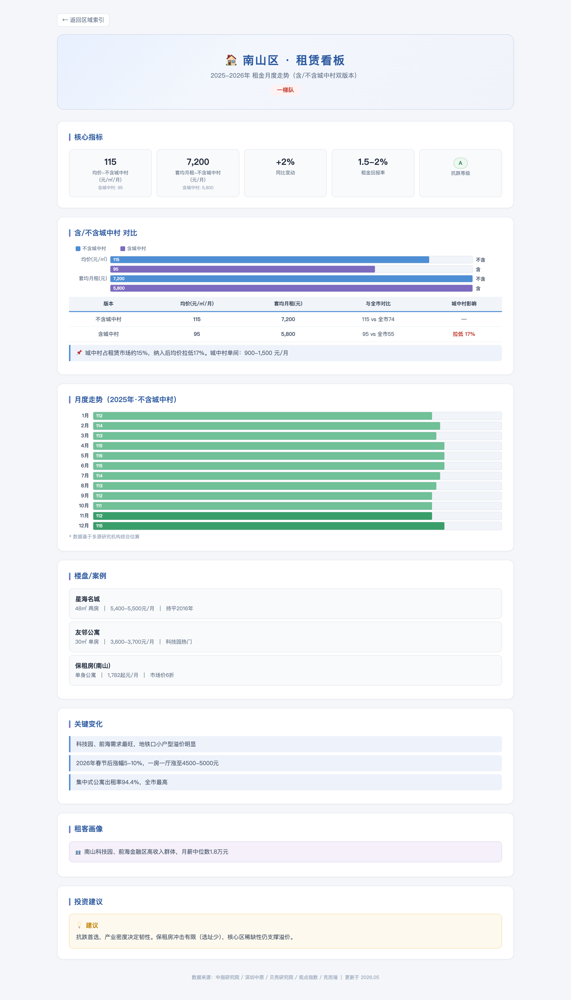
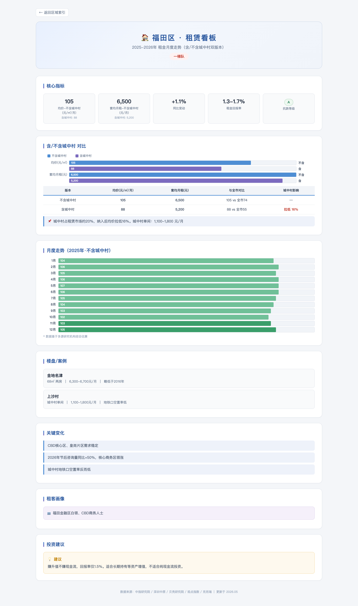
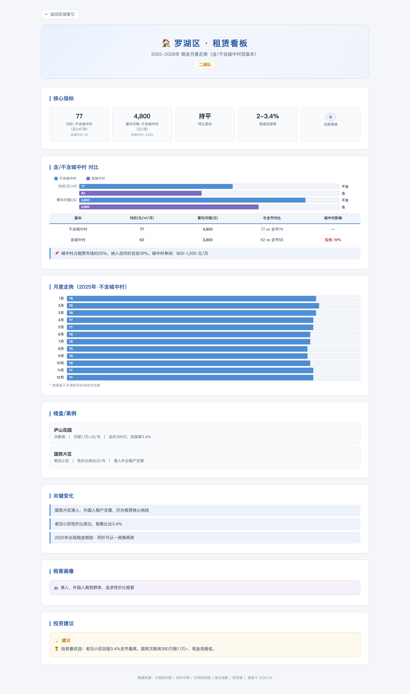
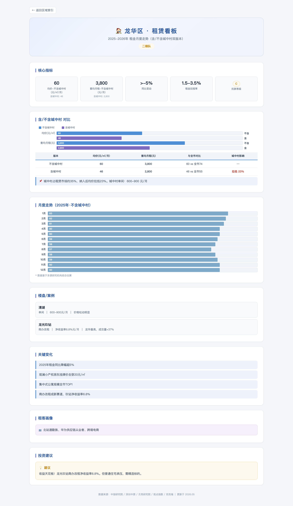
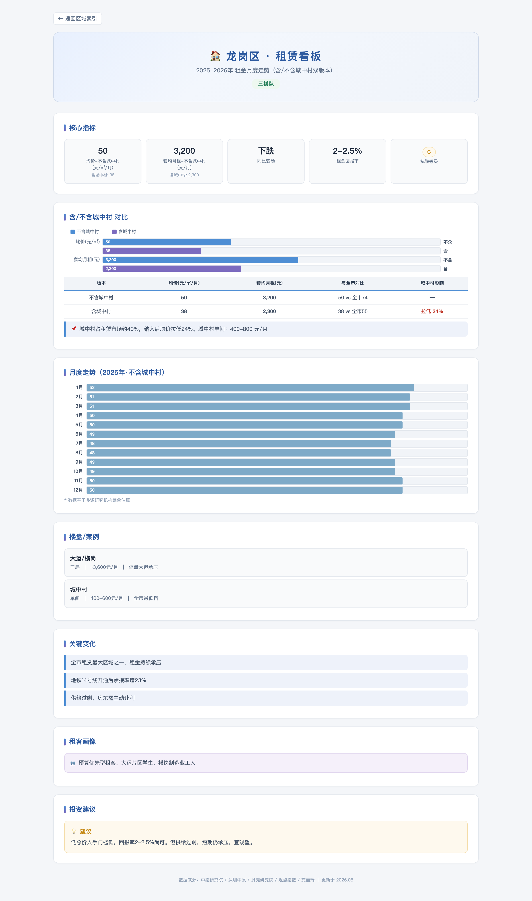
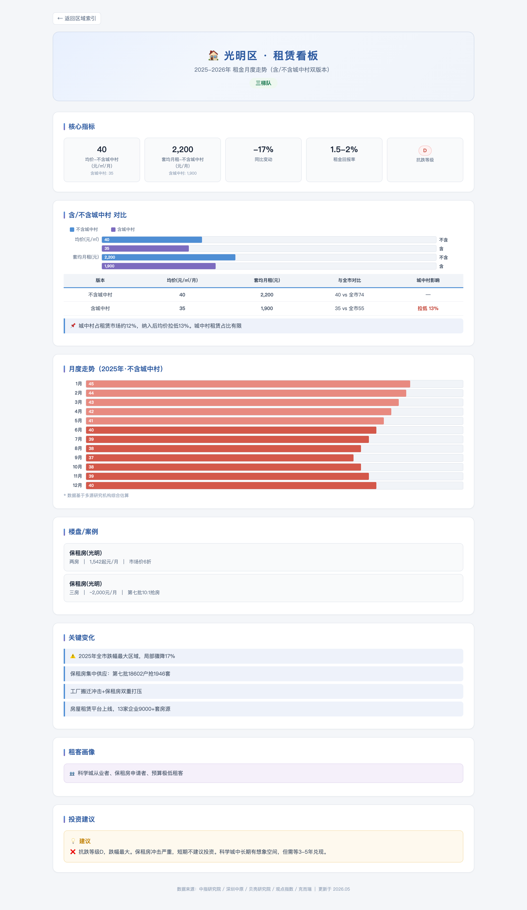
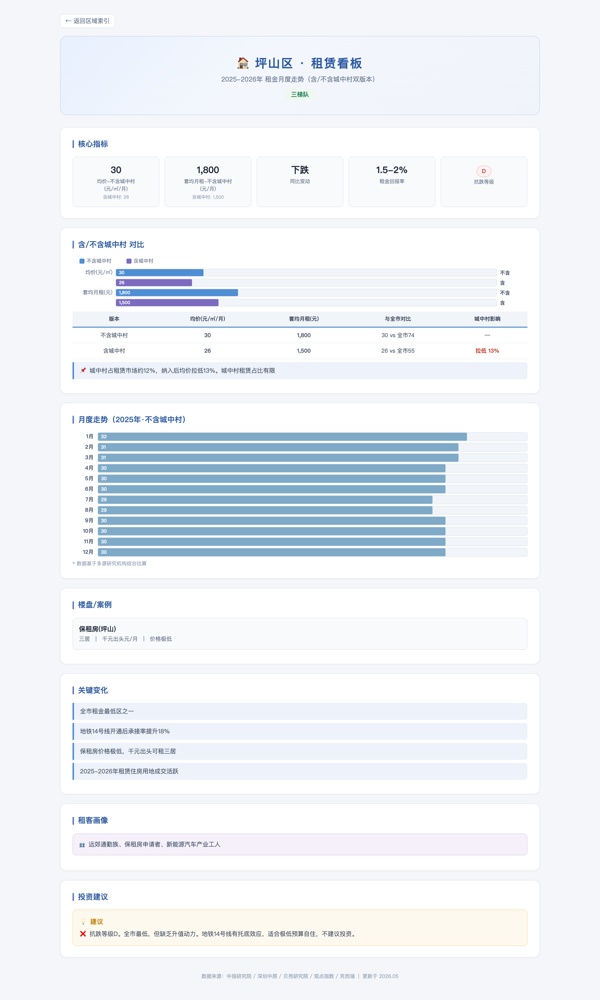
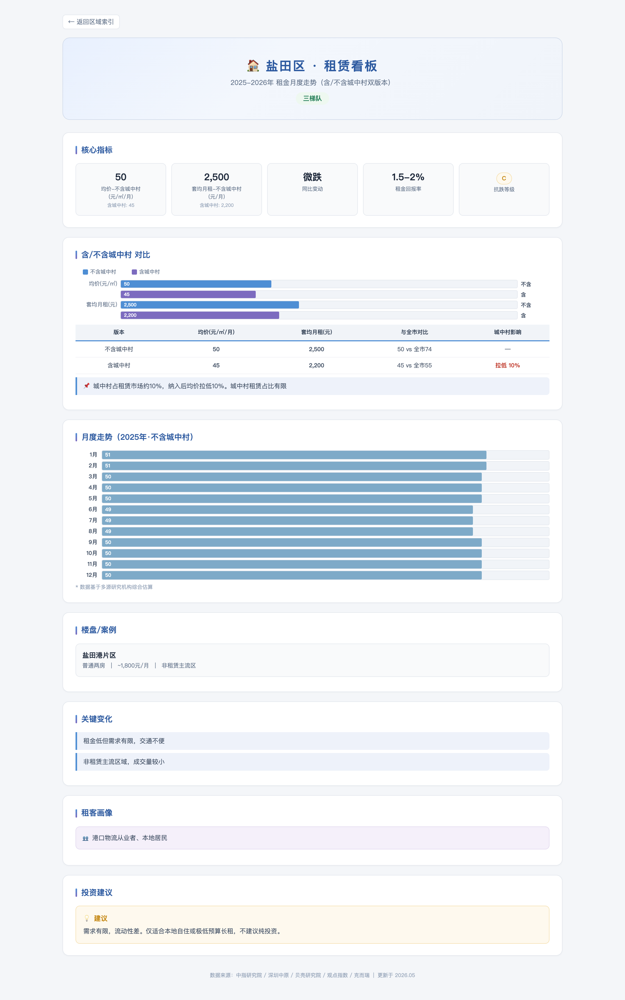

# 深圳租赁市场月度归档 · 2026-10

> 数据快照 · 每月1日自动生成

## 一、主看板

## 二、各区看板

### 第一梯队

#### 南山区

| 指标 | 值 |
|------|----|
| 均价(不含城中村) | 115 元/㎡/月 |
| 均价(含城中村) | 95 元/㎡/月 |
| 同比变动 | +2% |
| 抗跌等级 | A |
| 租金回报率 | 1.5-2% |

#### 福田区

| 指标 | 值 |
|------|----|
| 均价(不含城中村) | 105 元/㎡/月 |
| 均价(含城中村) | 88 元/㎡/月 |
| 同比变动 | +1.1% |
| 抗跌等级 | A |
| 租金回报率 | 1.3-1.7% |

### 第二梯队

#### 罗湖区

| 指标 | 值 |
|------|----|
| 均价(不含城中村) | 77 元/㎡/月 |
| 均价(含城中村) | 62 元/㎡/月 |
| 同比变动 | 持平 |
| 抗跌等级 | B |
| 租金回报率 | 2-3.4% |

#### 宝安区

| 指标 | 值 |
|------|----|
| 均价(不含城中村) | 62 元/㎡/月 |
| 均价(含城中村) | 48 元/㎡/月 |
| 同比变动 | 微跌 |
| 抗跌等级 | B |
| 租金回报率 | 1.8-2.5% |

#### 龙华区

| 指标 | 值 |
|------|----|
| 均价(不含城中村) | 60 元/㎡/月 |
| 均价(含城中村) | 46 元/㎡/月 |
| 同比变动 | >-5% |
| 抗跌等级 | C |
| 租金回报率 | 1.5-3.5% |

### 第三梯队

#### 龙岗区

| 指标 | 值 |
|------|----|
| 均价(不含城中村) | 50 元/㎡/月 |
| 均价(含城中村) | 38 元/㎡/月 |
| 同比变动 | 下跌 |
| 抗跌等级 | C |
| 租金回报率 | 2-2.5% |

#### 光明区

| 指标 | 值 |
|------|----|
| 均价(不含城中村) | 40 元/㎡/月 |
| 均价(含城中村) | 35 元/㎡/月 |
| 同比变动 | -17% |
| 抗跌等级 | D |
| 租金回报率 | 1.5-2% |

#### 坪山区

| 指标 | 值 |
|------|----|
| 均价(不含城中村) | 30 元/㎡/月 |
| 均价(含城中村) | 26 元/㎡/月 |
| 同比变动 | 下跌 |
| 抗跌等级 | D |
| 租金回报率 | 1.5-2% |

#### 盐田区

| 指标 | 值 |
|------|----|
| 均价(不含城中村) | 50 元/㎡/月 |
| 均价(含城中村) | 45 元/㎡/月 |
| 同比变动 | 微跌 |
| 抗跌等级 | C |
| 租金回报率 | 1.5-2% |

## 三、九区速览

| 区域 | 均价 | 含城中村 | 同比 | 抗跌 | 回报率 |
|------|------|---------|------|------|--------|
| 南山区 | 115 | 95 | +2% | A | 1.5-2% |
| 福田区 | 105 | 88 | +1.1% | A | 1.3-1.7% |
| 罗湖区 | 77 | 62 | 持平 | B | 2-3.4% |
| 宝安区 | 62 | 48 | 微跌 | B | 1.8-2.5% |
| 龙华区 | 60 | 46 | >-5% | C | 1.5-3.5% |
| 龙岗区 | 50 | 38 | 下跌 | C | 2-2.5% |
| 光明区 | 40 | 35 | -17% | D | 1.5-2% |
| 坪山区 | 30 | 26 | 下跌 | D | 1.5-2% |
| 盐田区 | 50 | 45 | 微跌 | C | 1.5-2% |

## 四、本月重大变化（2026.09，10-13 归档）

- **50城租金三连涨终结** — 9月33.97元/㎡/月环比-0.17%，但同比-2.23%为近25个月最小跌幅，中指定调筑底企稳信号明确
- **一线六连涨终结** — 一线整体-0.03%；深圳+0.09%与上海+0.52%为仅存上涨一线，京穗转跌
- **9.29购房贷款贴息新政** — 贝壳判断将推升10月成交，月供敏感刚需群体红利最明显
- **非核心区限购放开** — 非深户无社保可购2套；国庆前5日贝壳签约同比+23%、光明乐有家销售额环比+200%
- **租赁与买卖分化** — 买卖量价齐升（二手均价环比+2.5%、签约同比+32%）而租赁温和回落

## 五、关联文件

- [[2026-10-13 9月租赁市场月度通报]] — 本期通报正文
- [[租赁市场看板]] / [[区域分析看板]] / [[深圳租赁市场人口走势]] — vault 看板三件套
- [[深圳2025-2026租赁市场各区租金月度走势]] — 月度走势表（已补9月行）
- [在线看板](https://pip-uu.github.io/sz-rental-dashboard/integrated.html) — 数据推进至 2026.09
- 上期：[[月度归档/2026-09/归档|2026-09 归档]]（含8月收官数据）

